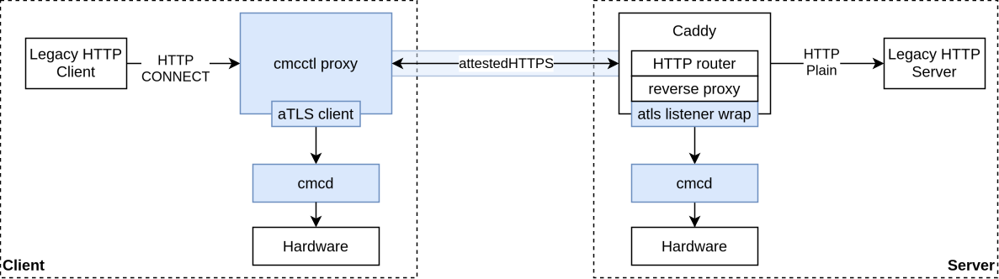

# Run

## Configuration

All binaries can be configured via TOML configuration files and commandline flags. Values apply in
the order defaults, configuration files, commandline flags, so a flag supersedes a file.

Without `--config`, each binary reads its default file `<config dir>/<binary>.toml` (`cmcd.toml`,
`cmcctl.toml`, `estserver.toml`, `cmcbackend.toml`) if it exists. `--config` replaces the default
file with a comma-separated list of files, where later files take precedence.

| Directory | root                    | non-root                                                      |
| --------- | ----------------------- | ------------------------------------------------------------- |
| config    | `/etc/cmc`              | `$XDG_CONFIG_HOME/cmc` (`~/.config/cmc`)                      |
| data      | `/var/lib/cmc/<binary>` | `$XDG_DATA_HOME/cmc/<binary>` (`~/.local/share/cmc/<binary>`) |
| run       | `/run/cmc`              | `$XDG_RUNTIME_DIR/cmc` (`~/.local/share/cmc/run`)             |

The defaults of options holding files, such as the trusted root CAs or the cmcd socket, live in
these directories. `--help` shows the expanded defaults.

The commandline flags for each executable can be shown via the `--help` flag, which groups them by
the configuration section they belong to. TOML configuration options are grouped into those same
sections (tables) and named in snake case (e.g. *cmc.attestation.hash_alg*), while commandline
flags stay flat and use kebab case (e.g. *--hash-alg*). Relative paths in a configuration file are
relative to the directory of that file, relative paths in flags to the working directory.

Exemplary TOML configuration files can be found in the `example-setup/configs/` folder of this
repository. Every binary can inspect and write its configuration with the `config` subcommand:

```sh
# Load and validate the configuration, exit code 0 if it is valid
estserver config validate --config example-setup/configs/est-server.toml

# Print the effective configuration, secrets redacted. --minimal prints only non-default options
cmcd config print --config example-setup/configs/cmcd.toml --minimal

# Write the defaults plus the given flags and --config files to the default file. Every option is
# documented, options at their default are commented out. --minimal writes only non-default options,
# --output selects another file (- for stdout) and --force overwrites an existing file or writes an
# invalid configuration
sudo cmcd config init --drivers tpm --metadata https://metadata.example.com/
```

Some options combine several values into a single string:

| Option        | Form                | Examples                                                                                      |
| ------------- | ------------------- | --------------------------------------------------------------------------------------------- |
| `cmc`         | `<api>://<address>` | `socket:///run/cmc/cmc.sock`, `socket://127.0.0.1:9955`, `grpc://127.0.0.1:9955`, or `libapi` |
| `endorsement` | `<mode>[:<url>]`    | `direct`, `host`, `est:https://localhost:9000`, `cps:https://localhost:9000`                  |
| `enrollment`  | `<mode>[:<url>]`    | `self`, `est:https://localhost:9000`                                                          |

## cmcctl commands

The cmcctl provides the following subcommands:

- **generate**: Generate attestation report
- **verify**: Verify attestation report
- **enroll-key**: Create and enroll a new TLS key
- **dial**: Establish attested TLS client
- **listen**: Establish attested TLS server
- **request**: Perform an attested HTTPS request
- **serve**: Establish an attested HTTPS server
- **token**: Request a bootstrap token for EST certificate requests
- **provision**: Retrieve provisioning data for CVMs
- **update-certs**: Triggers updating the CMC AK and IK certificates
- **update-metadata**: Triggers updating the CMC metadata
- **proxy**: Forward data over attested TLS using HTTP

## Run the framwork

### Run the EST and Provisioning Server

```sh
# Start the EST server that supplies the certificates and metadata for the cmcd
estserver --config example-setup/configs/est-server.toml
```

### Run the cmcd

Prerequisite: [est server running](./run.md#run-the-est-and-provisioning-server)

```sh
# Run the cmcd
cmcd --config example-setup/configs/cmcd.toml

# NOTE: for setups that require root, e.g., to access the tpm, make sure the installed go binaries
# are found:
sudo env PATH="$HOME/go/bin:$PATH" cmcd --config example-setup/configs/cmcd.toml
```

### Generate and Verify Attestation Reports

Prerequisite: [cmcd running](./run.md#run-the-cmcd)

```sh
# Run cmcctl to retrieve an attestation report (stored in current folder unless otherwise specified)
cmcctl generate --config example-setup/configs/cmcctl.toml

# Run cmcctl to verify the attestation report (stored in current folder unless otherwise specified)
cmcctl verify --config example-setup/configs/cmcctl.toml
```

### Establish Attested TLS Connections

Prerequisite: [cmcd running](./run.md#run-the-cmcd)

```sh

# Run an attested TLS server
cmcctl listen --config example-setup/configs/cmcctl.toml --addr "$(hostname --fqdn):4443"

# Run an attested TLS client estblishing a mutually attested TLS connection to the server
cmcctl dial --config example-setup/configs/cmcctl.toml --addr "$(hostname --fqdn):4443"
```

### Establish Attested TLS Connections without a shared PKI

By default, TLS certificates are enrolled via EST, which requires a shared PKI between prover and
verifier to. If this is not desired, e.g. for testing or when the CVM image is built
independently of the verifier, the `cmcd` can create self-signed TLS certificates
instead. This enables TLS channels which are solely authenticated through the attestation:

```json
{
    "cmc": { "provisioning": { "enrollment": "self" } }
}
```

The peer must then be configured to establish trust based on the attestation report only, without
validating the certificate chain:

```sh
# Run an attested TLS server with a self-signed TLS certificate
cmcctl listen --config <cmcctl-config> --addr "$(hostname --fqdn):4443" --attest server

# Run an attested TLS client trusting the server based on its attestation report only
cmcctl dial --config <cmcctl-config> --addr "$(hostname --fqdn):4443" --attest server \
    --attestation-only-trust
```

The attestation report is bound to the TLS session via an RFC 5705 exporter-derived nonce. It
therefore proves that the peer terminating the connection is genuine, without requiring a shared
PKI. `--attestation-only-trust` is only allowed if the peer is actually attested, i.e., in
attestation mode `server` (or `mutual` when combined with `--mtls`).

### Establish Attested HTTPS Connections

Prerequisite: [cmcd running](./run.md#run-the-cmcd)

```sh
# Run two attested HTTPS servers
cmcctl serve --config example-setup/configs/cmcctl.toml --addr "$(hostname --fqdn):8082"

# Perform multiple user-specified attested HTTPS requests to both servers. Each connection is
# attested, while multiple requests to the same server use the established attested TLS connections
cmcctl request \
    --config example-setup/configs/cmcctl.toml \
    --addr "https://$(hostname --fqdn):8082" \
    --method POST \
    --data "hello from attested HTTPS client" \
    --header "Content-Type: text/plain"
```

### Specify custom CA certificates

The below commands show how to build and run the cmcd. At runtime, a client can provide the cmcd
with root certificates that are to be used during the verification of the attestation report. If
these are not provided, the cmcd uses the system's root certificates instead. Under Linux, these are
commonly stored under `/etc/ssl/certs`. To temporarily add certificates, see the commands
using `SSL_CERT_FILE` and `SSL_CERT_DIR` below.

```sh
# Example with added custom certificates
SSL_CERT_FILE=../example-setup/pki/ca/ca.pem ./cmcd --config <config-file>
SSL_CERT_DIR=../example-setup/pki/ca/ ./cmcd --config <config-file>
```

### Run cmcctl in SGX-Enclave

See [SGX-Setup](./setup-sgx.md).

### Run legacy HTTP client and server via aTLS proxies

Prerequisite: [cmcd running](./run.md#run-the-cmcd)

```sh
# Run the caddy atls reverse proxy on localhost:4445 and a hello world plain HTTP server on localhost:8080
cd cmc
./caddy run --config example-setup/configs/hello-world-reverse-proxy.caddyfile

# Run the cmcctl HTTP (CONNECT) proxy on localhost:4443
cd cmc/cmcctl
./cmcctl proxy -config ../example-setup/configs/cmcctl.toml --allow-system-certs=true --attest server

# Request via proxy (running on localhost:4443) in HTTP CONNECT mode
curl -p -x http://localhost:4443 http://localhost:4445/

# Request via proxy (running on localhost:4443) in standard mode
curl -x http://localhost:4443 http://localhost:4445/
```

This runs the following setup:



As an alternative, use [reverse-proxy.caddyfile](../example-setup/configs/reverse-proxy.caddyfile)
to let Caddy act as a reverse proxy only and deploy your own HTTP server on `localhost:8080` and
use an HTTP client of your choice.
