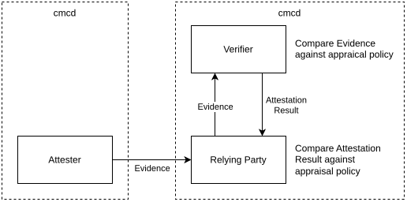
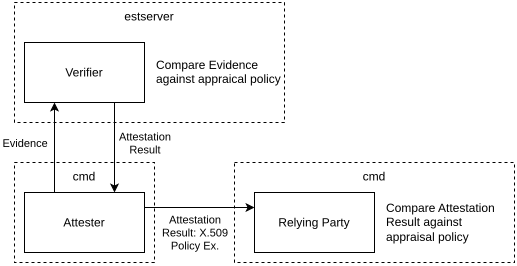

# Topological Patterns

The [IETF RATS architecture](https://www.rfc-editor.org/info/rfc9334/) defines different topoligical
patterns or attestation models with different data flows between attesters, verifiers and relying
parties (see [Architecture](./architecture.md) for an explanation of the different roles and the
generic data flow).

The document describes two reference models, the
[Background Check Model](https://www.rfc-editor.org/info/rfc9334/#section-5.2) and the
[Passport Model](https://www.rfc-editor.org/info/rfc9334/#section-5.1).

This framework primarily implements the background check model. The `cmcd` can act both as attester
and as verifier and relying party combined in one entity. However, the framework also supports the
passport model via [X.509 Certificate
Policies](https://www.rfc-editor.org/info/rfc5280/#section-4.2.1.4).

## Background Check Model

In the background check model, one `cmcd` and its client (`cmcctl` or any other third-party library
or client) acts as attester, and another `cmcd` and client act as combined verifier and relying
party. Evidence is not transferred unprotected over the wire, as this would open up the attestation
for different kinds of MitM attacks. Instead, the peers establish an attested channel via
`attestedtls` or `attestedhttps` that binds the attestation evidence to the channel.



## Passport Model

In the passport model, the attesting `cmcd` enrolls certificates through performing attestation with
a provisioning server, such as an [Enrollment over Secure Transport
(EST)](https://www.rfc-editor.org/info/rfc7030/) server
([tools/estserver](../tools/estserver/README.md)). The estserver acts as verifier during attestation
and issues certificates with certificate policy. The certificate policies state the attestation
level the key was enrolled with. The OIDs are described in the
[EST server documentation](../tools/estserver/README.md).

The client (`cmcctl` or any other third-party library or client) can then establish passport model
attestation-based TLS connections. During the TLS handshake, the verifying client then verifies that
the certificate contains a policy with the expected attestation level, which is proof that the
attester succesfully performed attestation, e.g.:

```sh
# Run estserver, enforce attestation for enrollment
estserver --auth-simpleenroll attestation

# Run the cmcd
cmcd

# Establish TLS connection with enforcement of hardware attestation via certificate (passport)
cmcctl listen --addr "$(hostname --fqdn):4443" --attest none
cmcctl dial --addr "$(hostname --fqdn):4443" --attest none --peer-cert-level hardware
```

Usually, such certs shall be short-lived to enforce regular re-attestation.





The certificate policy OIDs are
described in the [EST document](./est.md#certificate-policy-oids).